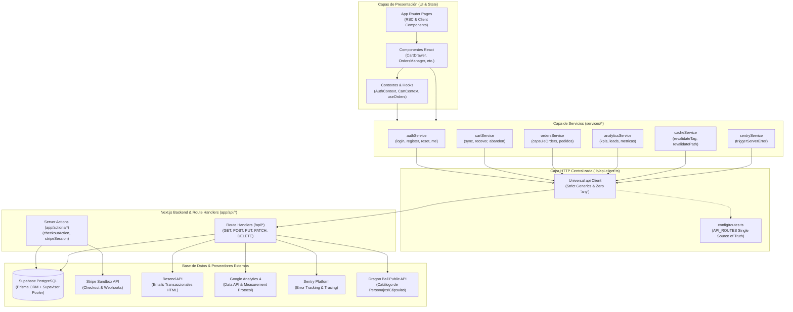

# 🚀 Capsule Corp Store — Fullstack Next.js E-Commerce & Platform


> **Plataforma E-Commerce y Sistema de Gestión Empresarial de Alta Tecnología** inspirada en el universo de *Dragon Ball Z*. Desarrollada con **Next.js 16 (Turbopack)**, **React 19**, arquitectura limpia en capas (**API $\rightarrow$ Service $\rightarrow$ Component**), base de datos **Supabase PostgreSQL** mediante **Prisma ORM**, pasarela **Stripe Sandbox**, correos transaccionales con **Resend**, analítica en tiempo real con **Google Analytics 4** y observabilidad continua con **Sentry**.

---

## 🏛️ Arquitectura del Sistema (Diagrama en Capas)

La aplicación sigue una arquitectura en capas estrictamente tipada y desacoplada, donde los componentes de interfaz nunca realizan peticiones HTTP directas ni manejan lógica de transporte cruda:



---

## ✨ Características Principales

### 1. Arquitectura en Capas y Type-Safety Estricto
- **Cliente HTTP Universal (`lib/api-client.ts`)**: Tipado estricto con **0 tipos `any`** (`@typescript-eslint/no-explicit-any` aprobado). Soporta autocompletado en métodos `get`, `post`, `put`, `patch` y `delete` a partir de los contratos de `types/api.ts`.
- **Servicios de Dominio (`services/*`)**: Abstracción de lógica de negocio y consumo de endpoints (`authService`, `cartService`, `ordersService`, `analyticsService`, `cacheService`, `sentryService`).
- **Single Source of Truth (`config/routes.ts`)**: Todas las rutas de páginas y endpoints de la API centralizadas en constantes inmutables.

### 2. E-Commerce de Cápsulas Hoi-Poi
- **Catálogo Dinámico**: Productos con rarezas, tipos de cápsula y niveles de poder (Z, S, A, B).
- **Gestión de Carrito Multi-Pestaña**: Sincronización en tiempo real mediante `useSyncExternalStore` con `localStorage` y soporte para cupones promocionales (ej. `HOIPOI10`).
- **Recuperación de Carrito Abandonado (1-Clic)**: Si el usuario abandona la pasarela de pago o no concreta la orden, se genera un token criptográfico único y se envía un correo transaccional vía **Resend** con un enlace directo para restaurar sus productos con descuento aplicado.

### 3. Pagos y Webhooks con Stripe
- **Checkout Seguro**: Creación de sesiones en modo Sandbox (`app/actions/stripe.ts`).
- **Webhooks Criptográficos**: Verificación de firmas `whsec_...` con `stripe.webhooks.constructEvent` y sincronización inmediata con Supabase.

### 4. Sistema Financiero de Pedidos a Plazos (Nenis)
- Módulo interno para registro y amortización quincenal de compras a plazos.
- Actualización en tiempo real de estados de pedido (`pendiente`, `aprobado`, `en_entrega`, `completado`, `cancelado`).

### 5. Analítica en Tiempo Real & Observabilidad
- **Google Analytics 4**: Reportes de usuarios activos, vistas de página y lectura completa mediante la API oficial `@google-analytics/data`.
- **Sentry SDK**: Monitoreo de excepciones tanto en el cliente como en el runtime de Node.js / Edge.

---

## 🔒 Manejo Seguro de Variables de Entorno

> [!IMPORTANT]
> **Ninguna credencial real, clave privada o token sensible está expuesto en este repositorio.**
> Los archivos `.env` y `.env.local` se encuentran estrictamente ignorados en [.gitignore](.gitignore). Solo se versiona la plantilla [.env.example](.env.example).

Para configurar tu entorno de desarrollo local, copia la plantilla:

```bash
cp .env.example .env.local
```

### Especificación de Variables

| Variable | Tipo | Requerida | Propósito |
| :--- | :--- | :---: | :--- |
| `NEXT_PUBLIC_APP_URL` | URL | Sí | URL base de la aplicación (ej. `http://localhost:3000`). |
| `DATABASE_URL` | Connection String | Sí | Conexión con Supavisor Pooler (puerto 6543) de Supabase compatible con IPv4. |
| `DIRECT_URL` | Connection String | Opcional | Conexión directa a PostgreSQL (puerto 5432) para migraciones de Prisma. |
| `NEXT_PUBLIC_SUPABASE_URL` | URL | Opcional | URL del proyecto Supabase. |
| `NEXT_PUBLIC_SUPABASE_ANON_KEY` | Public Key | Opcional | Clave pública de acceso cliente de Supabase. |
| `SUPABASE_SERVICE_ROLE_KEY` | Secret Key | Opcional | Clave con privilegios de administrador para operaciones backend. |
| `STRIPE_SECRET_KEY` | Secret Key | Opcional | Clave secreta de Stripe en modo pruebas (`sk_test_...`). |
| `NEXT_PUBLIC_STRIPE_PUBLISHABLE_KEY` | Public Key | Opcional | Clave publicable de Stripe Elements (`pk_test_...`). |
| `STRIPE_WEBHOOK_SECRET` | Secret Key | Opcional | Clave de firma para verificar eventos de Webhooks de Stripe (`whsec_...`). |
| `RESEND_API_KEY` | Secret Key | Opcional | API Key de Resend (`re_...`) para el envío de correos transaccionales. |
| `RESEND_FROM_EMAIL` | Email | Opcional | Remitente verificado (ej. `Capsule Corp <onboarding@resend.dev>`). |
| `NEXT_PUBLIC_GA_MEASUREMENT_ID` | String | Opcional | ID de flujo web de GA4 (`G-XXXXXXXXXX`). |
| `GA_PROPERTY_ID` | String | Opcional | ID numérico de propiedad de Google Analytics 4. |
| `GA_CLIENT_EMAIL` | Email | Opcional | Cuenta de servicio de Google Cloud para consultar reportes de GA4. |
| `GA_PRIVATE_KEY` | PEM String | Opcional | Clave privada RSA de la cuenta de servicio de Google Cloud. |
| `NEXT_PUBLIC_SENTRY_DSN` | DSN URL | Opcional | DSN de monitoreo de errores de Sentry. |

---

## 🛠️ Instalación y Puesta en Marcha

### Prerrequisitos
- **Node.js**: v20.x o superior
- **Gestor de Paquetes**: `pnpm` (recomendado) o `npm`

### Pasos

1. **Instalar dependencias**:
   ```bash
   pnpm install
   ```

2. **Configurar el entorno**:
   ```bash
   cp .env.example .env.local
   # Configura tu DATABASE_URL de Supabase u otra base de datos PostgreSQL
   ```

3. **Generar el cliente de Prisma**:
   ```bash
   pnpm exec prisma generate
   ```

4. **Sincronizar el esquema con la base de datos**:
   ```bash
   pnpm exec prisma db push
   ```

5. **Iniciar el servidor de desarrollo (con Turbopack)**:
   ```bash
   pnpm run dev
   ```
   Abre [http://localhost:3000](http://localhost:3000) en tu navegador.

---

## 🧪 Validación y Calidad de Código

El proyecto cuenta con controles estrictos de tipado estático y linting:

```bash
# Comprobación de tipos en todo el proyecto
pnpm exec tsc --noEmit

# Validación de reglas de ESLint
pnpm run lint

# Compilación de producción (45 rutas estáticas, dinámicas y PPR)
pnpm run build
```

---

## 📂 Estructura del Proyecto

```text
├── .github/
│   └── mundo_dbz.png              # Imagen artística de Capsule Corp HQ
├── app/
│   ├── actions/                   # Server Actions (Stripe, Cart Checkout)
│   ├── api/                       # Route Handlers de Next.js (REST API)
│   ├── auth/                      # Vistas de autenticación y reset de contraseña
│   ├── interno/                   # Módulo operativo interno
│   ├── sentry-test/               # Panel de pruebas para Sentry
│   └── layout.tsx & page.tsx      # Estructura principal de la app
├── components/
│   ├── dbz/                       # Componentes temáticos (CartDrawer, AbandonedCartManager, etc.)
│   ├── Navbar.tsx                 # Barra de navegación con contador de carrito
│   └── LandingKPIs.tsx            # Métricas dinámicas con Server Connection
├── config/
│   └── routes.ts                  # Rutas y endpoints tipados centralizados
├── context/
│   ├── AuthContext.tsx            # Estado global de usuario (authService)
│   └── CartContext.tsx            # Estado reactivo del carrito (cartService)
├── lib/
│   ├── api-client.ts              # Cliente HTTP universal fuertemente tipado (Zero Any)
│   ├── analytics.ts               # Despachador de eventos a GA4 y Meta Pixel
│   ├── email.ts                   # Plantillas y despacho de correos con Resend
│   ├── prisma.ts                  # Instancia singleton de PrismaClient con Supavisor
│   └── stripe.ts                  # Configuración del SDK de Stripe
├── prisma/
│   └── schema.prisma              # Esquema relacional (CapsuleOrder, AbandonedCart, Pedidos)
├── services/                      # Capa de Servicios desacoplada de la UI
│   ├── auth.service.ts
│   ├── cart.service.ts
│   ├── orders.service.ts
│   ├── analytics.service.ts
│   ├── cache.service.ts
│   ├── sentry.service.ts
│   └── index.ts                   # Re-export unificado
├── types/                         # Interfaces de TypeScript compartidas
│   ├── api.ts                     # Diccionario estricto de ApiEndpoints y modelos
│   ├── dragonball.ts              # Modelos canónicos y productos Hoi-Poi
│   └── general.ts                 # Tipos utilitarios y de contexto
└── .env.example                   # Plantilla segura de variables de entorno
```

---

## 📄 Licencia

Este proyecto es de uso personal y académico para fines demostrativos de ingeniería de software con Next.js y tecnologías web modernas. Los personajes y elementos conceptuales de Dragon Ball Z son propiedad intelectual de Akira Toriyama / Bird Studio / Shueisha / Toei Animation.
